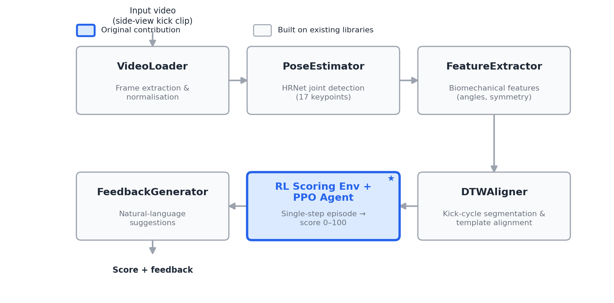
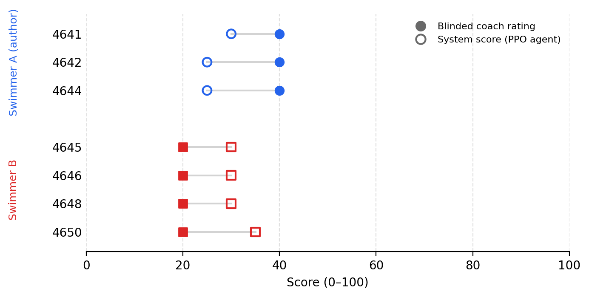

# Breaststroke Kick Evaluation System

A computer-vision pipeline that scores breaststroke kick technique from side-view video and generates feedback. Pose estimation and dynamic time warping (DTW) turn a clip into kinematic features. A reinforcement-learning agent then produces a score from 0 to 100.

This code supports an IB Extended Essay in Computer Science. The research question asks to what extent a reinforcement-learning-style reward function, built on a deep-learning pose pipeline, can evaluate the technical correctness of a kick. The essay text is not in this repository.

**Main finding:** the pipeline produces scores and feedback from video when pose extraction and scoring are run as separate steps, and the agent approximated the rule-based score on real clips (MAE 4.44 points). A simple linear fit does about as well, and the system did not reproduce a coach's ranking of two swimmers. The score is not yet a validated measure of technique.

## How it works



| Module | Role |
|---|---|
| `src/video_loader.py` | Extracts and resizes frames |
| `src/pose_estimator.py` | Detects 17 body keypoints with HRNet (MMPose) |
| `src/feature_extractor.py` | Computes 2D joint angles, symmetry and angular velocity, and repairs failed pose frames |
| `src/dtw_aligner.py` | Splits video into kick cycles and aligns each cycle to a reference template |
| `src/kick_env.py`, `src/train_agent.py` | Defines the scoring environment and trains the PPO agent |
| `src/feedback.py` | Turns deviations from the template into written suggestions |
| `src/pipeline.py` | Runs the modules end to end |

### Scoring design

The **reference score** is a fixed formula. Two of its terms use the template, which is a single 45-frame reference cycle. The other two do not.

| Factor | Weight | Uses the template |
|---|---|---|
| Joint-angle deviation | 0.40 | Yes |
| Timing (DTW warp) | 0.20 | Yes |
| Left-right symmetry | 0.20 | No |
| Smoothness | 0.20 | No |

Angle deviation is weighted across four equal time segments of the aligned cycle: 0.15, 0.20, 0.40 and 0.25. The code labels them recovery, catch, power and glide, but they are not detected biomechanical phases and do not line up well with the template's motion. For example, the knee is already almost straight in the segment labelled "power".

A score combines distance from this one reference cycle with symmetry and smoothness, which do not use it. It is not a percentage of correct technique. On real clips the reference score ranged only from 0 to 55.

The **PPO agent** sees one kick cycle as 28 summary statistics of joint angles, symmetry and angular velocity, and it chooses one of 21 scores (0, 5, ..., 100). Each episode has one step, so the task is effectively a contextual bandit. The observation excludes the template-based terms, but symmetry and smoothness can be computed directly from it. The policy does not read the template, but the current pipeline still requires one to run.

## Results

### Learning the rule-based score

The data comes from Kinetics-700 breaststroke clips. Of 237 source clips, 215 gave at least one valid cycle, for 575 cycles in total. The split is by video: 172 videos (468 cycles) for training and 43 videos (107 cycles) for testing.

| Model | Test MAE (score points) |
|---|---|
| Constant (training median) | 10.79 |
| kNN (k = 5) | 5.70 |
| MLP (256, 256) | 4.49 |
| **PPO agent** | **4.44** |
| Linear fit on the clipped symmetry and smoothness terms only | 4.25 |

The PPO agent has 59% lower error than predicting the training mean (MAE 10.84). Its predictions did not collapse to a constant: it used 9 distinct scores from 5 to 45, with a standard deviation of 11.2.

**The agent's accuracy does not show that it learned anything beyond the two terms it can compute.** The two-term linear fit has slightly lower error than PPO, but the gap is within sampling noise on 107 test cycles (PPO minus linear: 0.19 points, 95% CI −0.61 to 0.97, video-level bootstrap). The linear fit comes from a separate one-off check, and its script is not in this repository. These numbers measure how well a model approximates the formula. They do not measure whether the formula is correct.

### Comparison with a coach

A coach, who was not told about the system, watched 7 underwater clips of two swimmers and gave one score per swimmer. Swimmer A is the author.



| Swimmer | Clips | Coach score (per swimmer) | System score (per clip) |
|---|---|---|---|
| A | 3 | 40 | 30, 25, 25 |
| B | 4 | 20 | 30, 30, 30, 35 |

**The system did not reproduce the coach's ranking.** It ranked swimmer B slightly higher on average (31 against 27), the reverse of the coach's order. The gap is about the size of the agent's error on Kinetics, so the system could not reliably separate these swimmers. This is a small case study with two ratings from one coach, so it does not support general conclusions.

The comparison also showed a blind spot. The coach's only comment on swimmer A and first comment on swimmer B concerned the ankle or foot. The 17-keypoint model stops at the ankle, so the system has no ankle-angle feature and cannot detect these faults.

## Limitations

- **No external ground truth for training:** the training target is a formula, not expert ratings.
- **Test set not fully independent:** the reported model was not selected on the test cycles, but those cycles were monitored throughout development.
- **Formula partly visible to the agent:** symmetry and smoothness (0.40 of the weight) can be computed from the observation. A linear fit on these two terms accounts for most of the variation in test-set scores (R² 0.82), partly because they correlate with the angle term.
- **Viewpoint:** angles are measured in the 2D image plane, so they depend on the camera view, and Kinetics views vary.
- **Pose noise:** HRNet jitter on real footage raises the smoothness values well above those of synthetic data. The real-data score scales had to be recalibrated.
- **Underwater detection:** detector confidence on the self-filmed clips was generally about 0.17 to 0.31. All 7 clips could be scored only after the threshold was lowered from 0.3 to 0.1 and the highest-confidence box was selected. The pipeline default is still 0.3, and the command line does not expose this setting.
- **Sensitive scores:** several clips have only one valid cycle, and one clip's score moved from 15 to 25 after a detector change.
- **Geometric distortion:** the stored poses and the template came from an older non-proportional resize. The current code uses letterboxing, but the dataset and template have not been regenerated.
- **Uneven score distribution:** error is highest at the rare extremes (MAE 15.0 at score 0, n = 1; 10.0 at score 55, n = 2), against 2.3 at score 35 (n = 11).

## Run the tests

The tests run from a clean clone and do not need the pose-estimation libraries, the template or the model. Python 3.11 is the tested version.

```bash
python -m venv .venv
source .venv/bin/activate
pip install numpy scipy opencv-python-headless pyyaml gymnasium stable-baselines3 dtw-python scikit-learn matplotlib tqdm pytest
python -m pytest tests -q
```

## What is and is not included

| Included | Not included |
|---|---|
| Source code, tests and configuration | Trained PPO model (`models/`) |
| Pose and cycle data derived from Kinetics-700 (`data/kinetics/joints/`, `data/features/`) and earlier versions | Reference template (`data/templates/*.npy`) and its source video |
| Figures, tables and training logs | Source videos and features for the self-filmed clips, which show other people |

Because of these exclusions, a clean clone can run the tests but cannot reproduce the scores or the coach comparison. Some older logs and figures also predate later fixes. For example, `train_kinetics.log` reports an MAE from an earlier evaluation method.

**Retraining needs the reference template**, which `extract_template.py` builds from a reference video in the HRNet environment. A different video gives different targets, so the results above would not apply directly. With a template in place:

```bash
python -m src.train_agent --source kinetics --output_model models/ppo_kick_scorer_kinetics.zip
python scripts/baseline_ladder.py
```

Retraining gives similar but not identical results. `baseline_ladder.py` overwrites `baseline_ladder.log`.

**Scoring a clip** needs the template, a trained model and a features file:

```bash
python -m src.pipeline --features your_clip.npy --model models/ppo_kick_scorer_kinetics.zip
```

Creating a features file from video needs the HRNet environment. See `requirements.txt` for the MMPose installation order, which requires NumPy below 2.0. The author's saved model does not load through the pipeline in that environment, so the direct `--video` route does not currently work with it. Run `python extract_all.py --input_dir <dir> --output_dir <dir>` in the HRNet environment (`.mp4` input only), then score the resulting `.npy` in the environment above.

## Repository guide

| Path | Contents |
|---|---|
| `src/` | Pipeline modules |
| `scripts/` | Kinetics-700 batch pipeline (see `scripts/README.md`), baseline comparison and blind-rating tools (the 43-clip blind rating has not been run) |
| `tests/` | Test suite (47 tests) |
| `figures/`, `tables/` | Result figures, their scripts and result tables |
| `architecture.md` | Module design and interfaces |
| `STATE.md` | Development log |

## Use of AI tools

Development used Claude Code, an AI coding assistant, to write and review code. Commit trailers and `STATE.md` record this.
